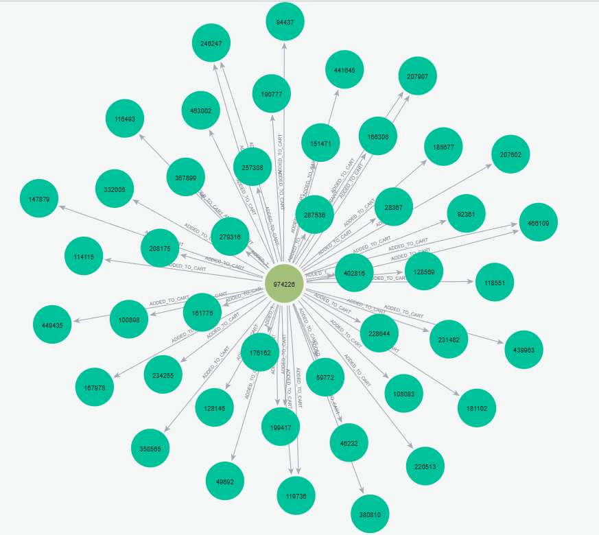
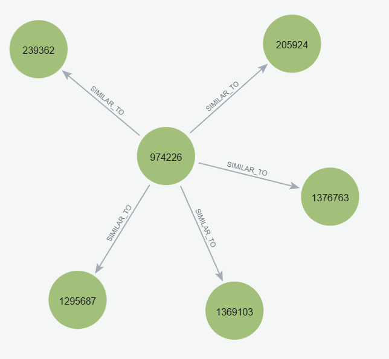

# UTS Graf Sains Data — Sistem Rekomendasi RetailRocket dengan Neo4j

**Mata kuliah:** Graf Sains Data | **Prodi:** S1 Sains Data, Universitas Negeri Surabaya
**Nama / NIM:** Nuraisi Maba Alhuda / 23031554054
**Dataset:** [RetailRocket E-commerce Dataset](https://www.kaggle.com/datasets/retailrocket/ecommerce-dataset) (berkas `events.csv`) dataset dapat diunduh secara mandiri dikarenakan memiliki ukuran yang cukup besar apabila di upload di repo ini
**Notebook utama:** `analisis_retailrocket.ipynb`

Dokumen ini menjelaskan setiap nomor soal UTS: **apa yang diminta**, **apa yang dilakukan kode**, **apa hasilnya**, dan **bagaimana cara membacanya**. Penomoran mengikuti notebook (nomor 1–8 untuk soal 2.1 _Wrangling dan EDA_, nomor 9–10 untuk soal 2.2 _Analytics_).

---

## Gambaran Umum Alur Pengerjaan

```
events.csv (data mentah)
   │  (No. 1–2) filter berdasarkan waktu
   ▼
training.csv  &  testing.csv
   │  (No. 3) data training dimuat ke Neo4j sebagai graf Visitor → Item
   ▼
Graf Neo4j  ──(No. 4–6)──►  matriks user-item (VSM)  ──►  proyeksi User–User / Item–Item
   │
   │  (No. 7–8) hitung cosine similarity, simpan sebagai relasi SIMILAR_TO
   ▼
(No. 9) rekomendasi berbasis KNN untuk satu user acak
   ▼
(No. 10) evaluasi dengan Hit@5 dan NDCG@5 memakai data testing
```

**Istilah yang dipakai:**

| Istilah                  | Arti sederhana                                                                                                                     |
| ------------------------ | ---------------------------------------------------------------------------------------------------------------------------------- |
| Simpul (node)            | Titik pada graf. Di sini ada dua jenis: `Visitor` (pengunjung) dan `Item` (produk).                                                |
| Relasi (relationship)    | Garis berarah antar simpul. Di sini: `VIEWED` (melihat), `ADDED_TO_CART` (memasukkan keranjang), `BOUGHT` (membeli).               |
| VSM (Vector Space Model) | Cara merepresentasikan sesuatu sebagai **vektor angka**. Setiap user = satu baris angka (apakah ia berinteraksi dengan tiap item). |
| Cosine similarity        | Ukuran kemiripan dua vektor, bernilai 0 (tidak mirip) sampai 1 (identik).                                                          |
| KNN                      | _K-Nearest Neighbors_: mengambil `k` tetangga terdekat (paling mirip) untuk dijadikan dasar rekomendasi.                           |

---

## Nomor 1 — Menentukan Dua Periode Waktu

**Yang diminta:** memilih 2 periode waktu sebagai filter data interaksi: satu untuk **training** (data untuk "belajar") dan satu untuk **testing** (data untuk "menguji" hasil rekomendasi). Kombinasi periode tiap mahasiswa tidak boleh sama.

**Yang dilakukan:** kolom `timestamp` pada dataset berupa _unix epoch_ dalam **milidetik** (jumlah milidetik sejak 1 Januari 1970). Kode menetapkan batas periode memakai `pd.Timestamp`:

| Periode       | Mulai      | Selesai (eksklusif) | Rentang efektif                     |
| ------------- | ---------- | ------------------- | ----------------------------------- |
| Training (P1) | 2015-07-05 | 2015-07-27          | 5 Juli – 26 Juli 2015 (22 hari)     |
| Testing (P2)  | 2015-07-27 | 2015-08-17          | 27 Juli – 16 Agustus 2015 (21 hari) |

**Penjelasan pilihan:**

- Training dan testing **berurutan dan tidak saling tumpang tindih**. Ini meniru kondisi nyata: sistem belajar dari masa lalu lalu diuji pada masa depan.
- Batas akhir dibuat **eksklusif** (`< TRAIN_END`) agar tidak ada data yang masuk ke dua periode sekaligus. Titik 27 Juli 00:00 hanya masuk periode testing.
- Zona waktu dipakai **UTC** supaya hasil sama di komputer mana pun.

---

## Nomor 2 — Menerapkan Filter dan Menyimpan ke `.csv`

**Yang diminta:** menerapkan filter periode pada `timestamp` saat persiapan data, lalu menyimpannya ke berkas `.csv`.

**Yang dilakukan:**

1. `events.csv` berukuran besar, sehingga dibaca **bertahap (chunk) 100.000 baris** dengan `pd.read_csv(..., chunksize=...)` agar memori tidak penuh.
2. Tiap chunk: kolom `timestamp` diubah menjadi tanggal (`pd.to_datetime(..., unit="ms", utc=True)`), lalu baris dipisah menjadi data training atau testing berdasarkan batas periode.
3. Hasil ditulis ke folder `data/filtered/` dengan mode _append_ (`mode="a"`) sehingga tiap chunk ditambahkan di akhir berkas. Berkas yang dihasilkan: `training.csv`, `testing.csv`, dan `filtered_events.csv` (gabungan keduanya dengan kolom tambahan `period`).
4. Sebelum mulai, berkas lama dihapus agar hasil tidak dobel jika sel dijalankan ulang.

**Hasil:**

|               | Training | Testing |
| ------------- | -------- | ------- |
| Jumlah baris  | 505.275  | 393.659 |
| `view`        | 488.837  | 379.767 |
| `addtocart`   | 12.420   | 10.563  |
| `transaction` | 4.018    | 3.329   |

Total data terfilter: **898.934 baris**. Tanggal paling awal dan paling akhir pada tiap berkas sudah dicek dan berada dalam periode yang ditentukan (training: 5 Juli 00:00 – 26 Juli 23:59; testing: 27 Juli 00:00 – 16 Agustus 23:59).

**Catatan pembacaan:** sekitar 96–97% interaksi hanyalah `view`. Pembelian sangat jarang (sekitar 0,8%), ciri khas data e-commerce.

---

## Nomor 3 — Komposisi Subgraph dengan Python API Neo4j

**Yang diminta:** query komposisi subgraph, uraikan jenis simpul dan jumlah tiap simpul memakai Python API, serta jelaskan Cypher yang digunakan.

**Koneksi.** Notebook memakai `GraphDatabase.driver(URI, auth=(USER, PASSWORD))` lalu membuka `driver.session(database="retail-rocket")`. Tes `RETURN 1` dijalankan untuk memastikan koneksi berhasil.

**Filter waktu di Cypher.** Karena relasi di Neo4j menyimpan `timestamp` dalam milidetik, batas periode diubah menjadi milidetik: `TRAIN_START_MS = 1436054400000` dan `TRAIN_END_MS = 1437955200000`. Nilai ini dikirim sebagai parameter `$start` dan `$end` (bukan ditulis langsung di query) agar aman dan mudah diganti.

**Query 1 — jumlah simpul dan relasi:**

```cypher
MATCH (v:Visitor)-[r]->(i:Item)
WHERE r.timestamp >= $start AND r.timestamp < $end
RETURN count(DISTINCT v) AS total_visitor,
       count(DISTINCT i) AS total_item,
       count(r)          AS total_relasi
```

Penjelasan baris demi baris:

- `MATCH (v:Visitor)-[r]->(i:Item)` — cari pola: sebuah Visitor yang punya relasi (jenis apa pun) ke sebuah Item.
- `WHERE r.timestamp >= $start AND r.timestamp < $end` — hanya relasi yang terjadi pada periode training.
- `count(DISTINCT v)` — hitung Visitor **unik**. Tanpa `DISTINCT`, satu visitor yang punya 10 relasi akan terhitung 10 kali.
- `count(r)` — hitung semua relasi (setiap relasi = satu interaksi).

**Query 2 — jumlah per jenis relasi:**

```cypher
MATCH (v:Visitor)-[r]->(i:Item)
WHERE r.timestamp >= $start AND r.timestamp < $end
RETURN type(r) AS jenis_relasi, count(r) AS jumlah
ORDER BY jumlah DESC
```

`type(r)` mengambil nama jenis relasinya, lalu dikelompokkan dan dihitung per jenis.

**Hasil subgraph training:**

| Jenis simpul | Jumlah  |
| ------------ | ------- |
| Visitor      | 278.635 |
| Item         | 107.628 |

| Jenis relasi  | Jumlah      | Persentase |
| ------------- | ----------- | ---------- |
| VIEWED        | 488.837     | 96,75%     |
| ADDED_TO_CART | 12.420      | 2,46%      |
| BOUGHT        | 4.018       | 0,80%      |
| **Total**     | **505.275** | 100%       |

**Validasi:** total relasi di Neo4j (505.275) sama persis dengan jumlah baris `training.csv` (505.275), jadi filter di Python dan filter di Cypher konsisten. Diagram batang komposisi juga ditampilkan di notebook.

---

## Nomor 4 — VSM untuk Simpul User

**Yang diminta:** membuat Vector Space Model untuk simpul yang berperan sebagai User, lalu menguraikan karakteristiknya (dimensi, shape, plot NetworkX, dst.).

**Cara membangun VSM.**

1. Ambil pasangan unik `(visitorid, itemid)` dari data training. Jika user melihat item yang sama berkali-kali, dihitung **satu** kali (505.275 interaksi menjadi **403.241** pasangan unik).
2. Beri nomor urut (indeks) pada tiap user dan tiap item agar bisa menjadi nomor baris dan kolom matriks.
3. Susun **matriks user-item**: tiap **baris = satu user**, tiap **kolom = satu item**, nilai **1** jika user pernah berinteraksi dengan item tersebut, **0** jika tidak (representasi biner).
4. Matriks disimpan sebagai **sparse matrix (CSR)** karena hampir seluruh isinya nol.

**Karakteristik matriks:**

| Karakteristik                          | Nilai                         |
| -------------------------------------- | ----------------------------- |
| Dimensi (jumlah sumbu)                 | 2 (matriks)                   |
| Shape                                  | 278.635 baris × 107.628 kolom |
| Setiap user diwakili vektor berdimensi | 107.628 (satu fitur per item) |
| Nilai non-nol                          | 403.241                       |
| Densitas                               | 0,00134463%                   |
| Sparsity                               | 99,99865537%                  |
| Rata-rata item per user                | sekitar 1,45                  |

**Cara membaca:**

- Matriks berukuran 278.635 × 107.628 punya sekitar 30 miliar sel. Jika disimpan penuh (dense), memerlukan sekitar **120 GB** (float32). Karena hanya 403.241 sel yang berisi 1, bentuk sparse hanya memerlukan beberapa MB. Inilah alasan memakai `csr_matrix`.
- Rata-rata user hanya berinteraksi dengan sekitar 1,45 item. Artinya vektor user sangat "jarang", dan banyak pasangan user akan punya similarity 0 karena tidak berbagi item.

**Proyeksi User–User.** Kemiripan antar-user dihitung dengan **cosine similarity**:

> cos(A, B) = (A · B) / (‖A‖ × ‖B‖)

Untuk vektor biner, ini sama dengan: _jumlah item yang sama_ ÷ √(jumlah item A × jumlah item B).

Menghitung similarity seluruh 278.635 user akan menghasilkan matriks sangat besar, sehingga untuk visualisasi dipilih **30 user paling aktif** (item unik terbanyak). Matriks sampel berukuran 30 × 107.628, dan matriks similarity-nya 30 × 30.

**Plot NetworkX.** Setiap user menjadi simpul. Untuk tiap user, diambil maksimal **3 tetangga** dengan similarity tertinggi (skor > 0), lalu dihubungkan dengan sisi berbobot similarity. Posisi simpul memakai `spring_layout(seed=42)` supaya gambar sama setiap dijalankan. Hasilnya: **30 simpul dan 76 sisi**. (Maksimal teoretis 30 × 3 = 90; menjadi 76 karena beberapa pasangan saling memilih sehingga sisinya bergabung.)

**Catatan:** memilih 30 sampel hanya untuk visualisasi. Ukuran VSM yang sesungguhnya tetap 278.635 × 107.628.

---

## Nomor 5 — VSM untuk Simpul Item

**Yang diminta:** VSM untuk simpul Item beserta karakteristiknya.

**Cara membangun.** Idenya sama dengan nomor 4, tetapi sudut pandangnya dibalik: matriks user-item **ditranspos** sehingga tiap **baris = satu item** dan tiap **kolom = satu user**. Item diwakili oleh pola siapa saja yang berinteraksi dengannya.

**Karakteristik:**

| Karakteristik                          | Nilai                            |
| -------------------------------------- | -------------------------------- |
| Shape matriks Item–User                | 107.628 baris × 278.635 kolom    |
| Setiap item diwakili vektor berdimensi | 278.635 (satu fitur per user)    |
| Rata-rata user per item                | sekitar 3,75 (403.241 ÷ 107.628) |

Untuk visualisasi, dipilih **30 item dengan interaksi terbanyak**. Matriks similarity-nya berukuran 30 × 30, dan graf NetworkX dibangun dengan aturan yang sama (maksimal 3 tetangga terdekat) menghasilkan **30 simpul dan 53 sisi**.

**Tabel perbandingan hasil nomor 4 dan 5:**

| Karakteristik           | Proyeksi User | Proyeksi Item |
| ----------------------- | ------------- | ------------- |
| Jumlah simpul VSM penuh | 278.635       | 107.628       |
| Jumlah fitur per simpul | 107.628       | 278.635       |
| Simpul pada visualisasi | 30            | 30            |
| Sisi pada visualisasi   | 76            | 53            |

---

## Nomor 6 — Proyeksi Mana yang Lebih Baik?

**Yang diminta:** berdasarkan nomor 4 dan 5, tentukan proyeksi yang lebih baik, dari sisi efektif dan efisien.

**A. Efisiensi (seberapa murah dihitung)**

Jika similarity dihitung untuk **semua pasangan simpul**, ukuran matriks similarity adalah jumlah simpul dikuadratkan:

|                                       | User–User         | Item–Item         |
| ------------------------------------- | ----------------- | ----------------- |
| Jumlah simpul                         | 278.635           | 107.628           |
| Ukuran matriks similarity penuh       | ≈ 77,6 miliar sel | ≈ 11,6 miliar sel |
| Perkiraan memori jika dense (float32) | ≈ 311 GB          | ≈ 46 GB           |

Proyeksi **Item–Item sekitar 6,7 kali lebih kecil**, sehingga lebih efisien jika seluruh similarity harus dihitung.

**B. Efektivitas (seberapa sesuai dengan tujuan)**

- **User–User** cocok untuk mencari _pengguna yang berperilaku serupa_, sehingga langsung dipakai pada **KNN berbasis pengguna** (soal 2.2 meminta KNN untuk seorang user).
- **Item–Item** cocok untuk mencari _produk yang sering dikonsumsi oleh orang yang sama_.
- Jumlah sisi pada plot (76 vs 53) **tidak bisa dijadikan bukti** bahwa satu proyeksi lebih efektif, karena dipengaruhi pemilihan 30 sampel dan aturan "3 tetangga terdekat". Efektivitas yang sebenarnya perlu diukur dengan metrik seperti Hit@5 dan NDCG@5 (nomor 10).

**C. Keputusan untuk langkah berikutnya**

Proyeksi **User–User** dipilih untuk nomor 7 dan 9 karena tujuan soal adalah merekomendasikan item kepada seorang user lewat KNN. Kekurangan efisiensinya diatasi dengan **tidak menghitung seluruh matriks 278.635 × 278.635**. Yang dihitung hanya **satu baris**, yaitu kemiripan _user acuan_ terhadap semua user lain (1 × 278.635). Dengan cara ini biaya komputasinya kecil.

---

## Nomor 7 — Perhitungan Similarity pada Graf Terproyeksi

**Yang diminta:** (a) Cypher untuk mendapatkan 5 record dengan similarity tertinggi dari satu record acuan yang ditentukan sendiri; (b) menuliskan kembali nilai similarity tersebut ke graf dan menunjukkan hasil query-nya.

**Langkah 1 — Hitung similarity di Python.**
User acuan: **`974226`**. Kode mencari indeks user tersebut, menghitung `cosine_similarity` terhadap seluruh user, mengabaikan dirinya sendiri (skor diset −1), lalu mengambil 5 skor tertinggi dengan `np.argsort`.

| Peringkat | User mirip | Cosine similarity |
| --------- | ---------- | ----------------- |
| 1         | 1369103    | 0,147264          |
| 2         | 1376763    | 0,138190          |
| 3         | 205924     | 0,121487          |
| 4         | 239362     | 0,109764          |
| 5         | 1295687    | 0,109764          |

(Peringkat 4 dan 5 bernilai sama; itu wajar karena cosine similarity pada data biner menghasilkan angka yang bisa kembar.)

**Langkah 2 — (b) Tulis kembali similarity ke graf Neo4j.** Hasil DataFrame diubah menjadi daftar dictionary lalu dikirim ke Cypher:

```cypher
UNWIND $records AS row
MATCH (u:Visitor {visitorId: row.reference_user})
MATCH (v:Visitor {visitorId: row.similar_user})
MERGE (u)-[r:SIMILAR_TO]->(v)
SET r.similarity = row.similarity,
    r.method = 'cosine_similarity',
    r.period = 'training_2015-07-05_to_2015-07-26'
RETURN count(r) AS jumlah_relasi
```

- `UNWIND $records AS row` — memecah daftar menjadi baris-baris satu per satu.
- `MATCH ... MATCH ...` — menemukan simpul user acuan dan simpul user mirip yang **sudah ada** di graf.
- `MERGE (u)-[r:SIMILAR_TO]->(v)` — membuat relasi `SIMILAR_TO` **hanya jika belum ada**, jadi menjalankan sel dua kali tidak membuat relasi ganda.
- `SET` — menyimpan nilai similarity beserta metode dan periodenya sebagai properti relasi.
- Hasil: **5 relasi** tersimpan.

**Langkah 3 — (a) Cypher untuk mengambil 5 similarity tertinggi:**

```cypher
MATCH (u:Visitor {visitorId: $reference_user})-[r:SIMILAR_TO]->(v:Visitor)
RETURN u.visitorId AS user_referensi,
       v.visitorId AS user_mirip,
       r.similarity AS similarity
ORDER BY similarity DESC
LIMIT 5
```

- `MATCH` mengikuti relasi `SIMILAR_TO` yang keluar dari user acuan.
- `ORDER BY similarity DESC` mengurutkan dari yang terbesar.
- `LIMIT 5` hanya mengambil 5 teratas.

Hasil query ini **identik** dengan tabel pada Langkah 1, artinya penyimpanan ke graf berhasil dan tidak ada nilai yang berubah.

---

## Nomor 8 — Kondisi Graf Sebelum dan Sesudah Perhitungan Similarity

**Yang diminta:** Cypher dan tampilan graf yang memperlihatkan kondisi sebelum dan sesudah perhitungan similarity.

**Sebelum** (belum ada relasi `SIMILAR_TO`; user-user hanya terhubung secara tidak langsung lewat item yang sama):

```cypher
// Menghitung relasi SIMILAR_TO yang ada (hasil: 0)
MATCH ()-[r:SIMILAR_TO]->()
RETURN count(r) AS jumlah_similar_to;

// Menampilkan user acuan dan 5 user yang kelak menjadi tetangga
MATCH (u:Visitor)
WHERE u.visitorId IN [974226, 1369103, 1376763, 205924, 239362, 1295687]
RETURN u;
```



**Sesudah** (user acuan kini terhubung langsung ke 5 user paling mirip lewat `SIMILAR_TO` yang berbobot):

```cypher
MATCH p = (u:Visitor {visitorId: 974226})-[r:SIMILAR_TO]->(v:Visitor)
RETURN p;
```



**Perbandingan:**

| Kondisi | Relasi `SIMILAR_TO` | Informasi pada graf                                                            |
| ------- | ------------------- | ------------------------------------------------------------------------------ |
| Sebelum | 0                   | Hanya relasi `VIEWED`, `ADDED_TO_CART`, `BOUGHT` antara Visitor dan Item       |
| Sesudah | 5                   | Ada relasi baru antar-Visitor dengan properti `similarity`, `method`, `period` |

Perbedaannya: graf menjadi **menyimpan pengetahuan hasil komputasi** (kemiripan antar-user) sehingga bisa langsung di-_query_ tanpa menghitung ulang.

---

## Nomor 9 — Rekomendasi KNN untuk Seorang User Acak (Analytics 1)

**Yang diminta:** memilih seorang user secara acak (prosesnya harus dapat direproduksi), menuliskan skrip Python rekomendasi KNN, dan memberi 3 item yang diiklankan untuk k = 5.

### 9.1 Memilih user acak yang reproducible

```python
eligible_users = sorted(set(train_df["visitorid"]) & set(test_df["visitorid"]))
rng = np.random.default_rng(2026)
for u in rng.permutation(eligible_users): ...
```

- **Kandidat** hanya user yang muncul di **training dan testing**. Alasannya: user perlu punya riwayat untuk dicari tetangganya (training) dan punya data masa depan untuk dinilai (testing).
- Daftar kandidat diurutkan dengan `sorted(...)` agar urutan awalnya selalu sama.
- Pengacakan memakai **seed 2026** (`default_rng(2026)`), sehingga siapa pun yang menjalankan kode ini mendapat urutan acak yang sama.
- User pertama dalam urutan acak yang memiliki **minimal 5 item unik** di training dipilih, agar profilnya cukup untuk dibandingkan.
- Hasil: **user `1048300`** (10 item unik di training).

### 9.2 Skrip KNN (k = 5)

1. **Hitung kemiripan** user target terhadap semua user dengan cosine similarity, lalu abaikan dirinya sendiri.
2. **Ambil 5 tetangga** dengan similarity tertinggi (hanya yang > 0):

| Tetangga | visitorid | Similarity |
| -------- | --------- | ---------- |
| 1        | 635956    | 0,447214   |
| 2        | 998393    | 0,365148   |
| 3        | 852252    | 0,365148   |
| 4        | 1175898   | 0,316228   |
| 5        | 162912    | 0,316228   |

3. **Skor KNN tiap item** = jumlah similarity dari tetangga yang pernah berinteraksi dengan item itu (`neighbor_matrix.T.dot(neighbor_scores)`). Item yang dipakai banyak tetangga yang sangat mirip mendapat skor tinggi.
4. **Normalisasi** skor KNN dan skor popularitas ke rentang 0–1.
5. **Skor akhir (hybrid)** = `0,8 × skor KNN + 0,2 × skor popularitas`. Komponen popularitas ditambahkan sebagai pelengkap karena data sangat jarang (tiap user hanya punya sedikit item sehingga sinyal dari tetangga terbatas).
6. **Buang item yang sudah dilihat user** pada training (skor diset 0), karena merekomendasikan barang yang sudah pernah diakses kurang bermanfaat.
7. **Urutkan** skor dari terbesar dan ambil 5 teratas.

### 9.3 Hasil

**Top-5 rekomendasi:**

| Peringkat | Item ID | Skor     |
| --------- | ------- | -------- |
| 1         | 139918  | 0,365822 |
| 2         | 158685  | 0,360838 |
| 3         | 5411    | 0,200000 |
| 4         | 445351  | 0,181620 |
| 5         | 461686  | 0,176324 |

**Tiga item yang diiklankan (k = 5): `139918`, `158685`, dan `5411`.**

**Catatan membaca hasil:**

- Skor item peringkat 3 tepat **0,2**. Nilai ini sama dengan 0,8 × 0 + 0,2 × 1, yang mengindikasikan item tersebut masuk karena **komponen popularitas** (skor KNN-nya nol), bukan karena dipakai oleh tetangga.
- Jumlah item bernilai positif adalah 107.618, yaitu 107.628 item dikurangi 10 item yang sudah dilihat user. Ini terjadi karena komponen popularitas memberi skor positif ke hampir semua item.

---

## Nomor 10 — Evaluasi Hit@5 dan NDCG@5 (Analytics 2)

**Yang diminta:** menghitung Hit@5 dan NDCG@5 dari rekomendasi nomor 9.

**Definisi relevan.** Item _relevan_ adalah item yang benar-benar diakses user target pada **periode testing** (27 Juli – 16 Agustus 2015). Untuk user `1048300` ada **11 item relevan**:
`387330, 76770, 186820, 366282, 300431, 284176, 79955, 143891, 80726, 211478, 141146`.

**Rumus:**

- **Hit@5** = 1 jika setidaknya satu dari 5 rekomendasi ada di daftar item relevan, selain itu 0.
- **DCG@5** = Σ relᵢ ÷ log₂(i + 1), untuk peringkat i = 1…5. Item relevan di peringkat atas bernilai lebih besar. (Di kode `log2(rank + 2)` karena `rank` dimulai dari 0.)
- **IDCG@5** = DCG pada kondisi ideal, yaitu semua posisi teratas relevan. Karena relevan ada 11 (> 5), maka ideal = 5 posisi relevan: 1 + 0,6309 + 0,5 + 0,4307 + 0,3869 ≈ **2,9485**.
- **NDCG@5** = DCG@5 ÷ IDCG@5, bernilai 0 sampai 1.

**Hasil:**

| Rekomendasi (peringkat 1–5) | Relevansi |
| --------------------------- | --------- |
| 139918                      | 0         |
| 158685                      | 0         |
| 5411                        | 0         |
| 445351                      | 0         |
| 461686                      | 0         |

| User    | Item relevan | Hit@5 | NDCG@5  |
| ------- | ------------ | ----- | ------- |
| 1048300 | 11           | **0** | **0,0** |

**Interpretasi:**

- Tak satu pun dari 5 item rekomendasi muncul pada interaksi user di periode testing, sehingga Hit@5 = 0 dan DCG = 0, yang membuat NDCG@5 = 0.
- Hasil 0 bukan berarti kode salah. Penyebab yang masuk akal:
  1. Ruang pilihan sangat besar (107.628 item) sedangkan hanya 11 yang relevan, jadi peluang kebetulan sangat kecil.
  2. Data sangat jarang (rata-rata ± 1,45 item per user), sehingga tetangga KNN hanya memberi sedikit sinyal.
  3. Evaluasi dilakukan pada **satu user saja**. Hasil satu user adalah contoh kasus, bukan ukuran kinerja sistem secara umum. Untuk menilai sistem secara utuh, Hit@5 dan NDCG@5 sebaiknya dirata-ratakan pada banyak user.

---

## Kesimpulan

1. Data dibagi berdasarkan waktu menjadi training (505.275 baris) dan testing (393.659 baris), lalu data training dimuat ke Neo4j sebagai graf Visitor → Item dengan 278.635 visitor, 107.628 item, dan 505.275 relasi.
2. VSM user-item berukuran 278.635 × 107.628 dengan sparsity 99,9987%, sehingga wajib disimpan sebagai sparse matrix.
3. Proyeksi Item–Item lebih efisien (± 6,7 kali lebih kecil), sedangkan proyeksi User–User dipilih untuk KNN karena tujuannya merekomendasikan item kepada user.
4. Similarity (cosine) dapat disimpan kembali sebagai relasi `SIMILAR_TO` di Neo4j sehingga bisa di-query langsung.
5. Pada user acak `1048300`, rekomendasi KNN (k = 5) menghasilkan Hit@5 = 0 dan NDCG@5 = 0. Ini mencerminkan keterbatasan data yang sangat jarang dan evaluasi pada satu user.

---

## Cara Menjalankan Ulang

1. Buat dan aktifkan _virtual environment_, lalu pasang paket: `neo4j`, `pandas`, `numpy`, `scipy`, `scikit-learn`, `networkx`, `matplotlib`, `tqdm`.
2. Unduh dataset dari Kaggle (lihat tautan di atas) dan letakkan `events.csv` di folder `data/`.
3. Jalankan Neo4j, buat database `retail-rocket`, lalu impor data training ke graf (skrip impor batch dari soal 1.3).
4. Atur kredensial Neo4j **lewat variabel lingkungan** (jangan menulis kata sandi langsung di notebook):
   ```python
   import os
   URI = os.getenv("NEO4J_URI", "bolt://127.0.0.1:7687")
   USER = os.getenv("NEO4J_USER", "neo4j")
   PASSWORD = os.getenv("NEO4J_PASSWORD")
   ```
5. Jalankan seluruh sel pada `analisis_retailrocket.ipynb` secara berurutan.
